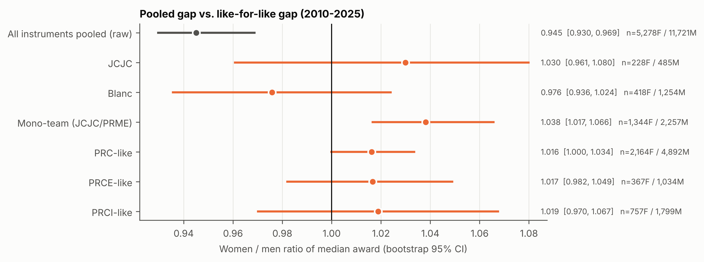
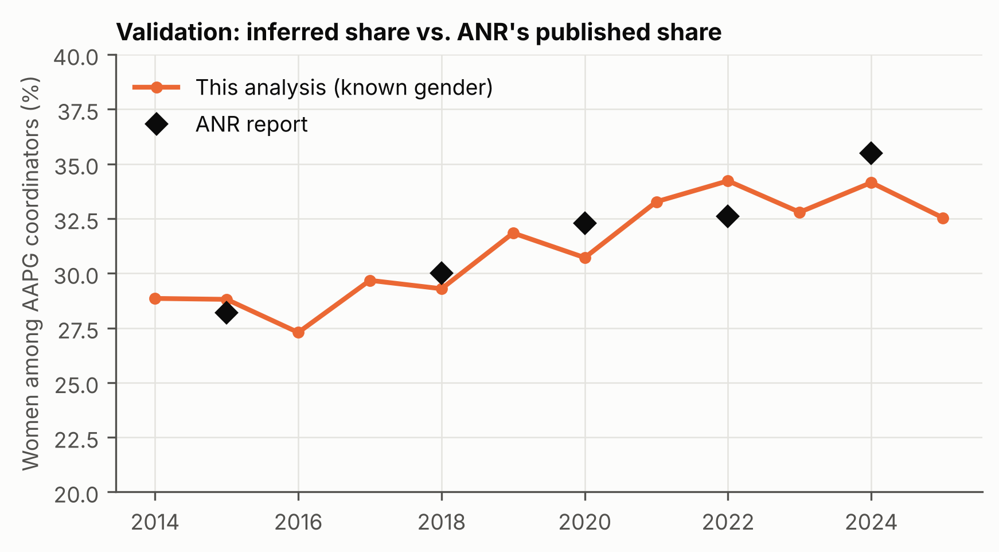
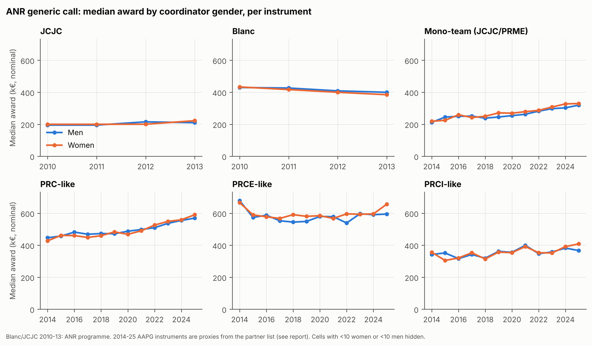
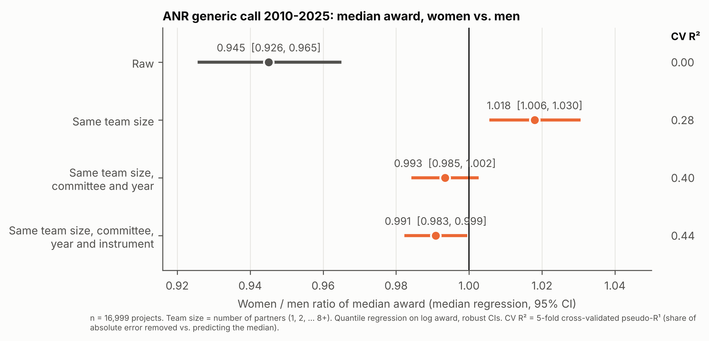
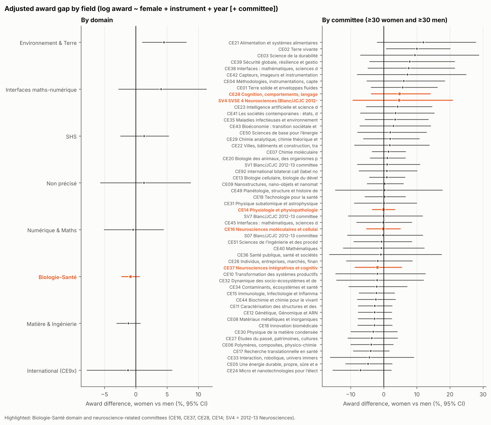
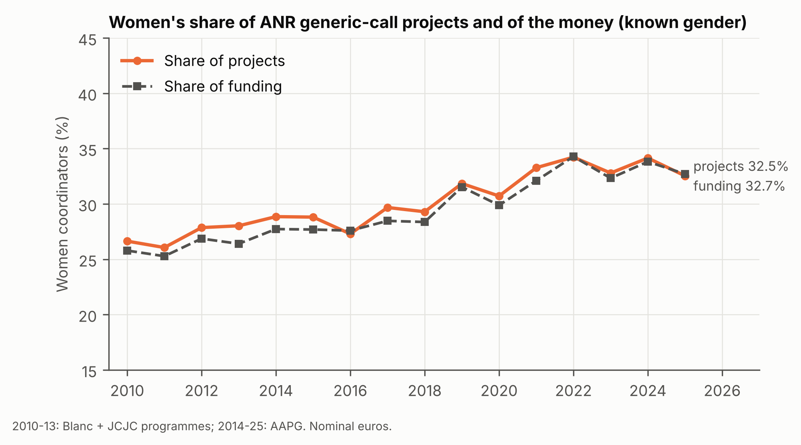

# ANR funding by coordinator gender

Do ANR generic-call projects led by women receive smaller awards than comparable projects led by men?

## Summary

1. **Comparing like with like, there is no award gap.** Holding instrument, call year and evaluation committee fixed, projects led by women receive **+0.1% [95% CI −1.0%, +1.1%]** the amount of men's projects (16,999 projects, 2010–2025). Adding the number of partners gives **−0.6% [−1.5%, +0.3%]**.
2. Within each instrument, the women/men ratio of median awards runs from 0.98 to 1.04 (figure 3). Four of the six CIs include 1; the other two (Mono-team, PRC-like) sit slightly above 1, in women's favour.
3. The pooled raw median is 5.5% lower for women (ratio 0.945 [0.930, 0.969]). This is a composition effect: women lead a larger share of single-team projects (JCJC/PRME), which are smaller grants. It is not a like-for-like gap.
4. Biologie-Santé shows no gap (−0.8% [−2.2%, +0.5%]), nor do the neuroscience committees (CE16 −0.2%, CE37 −1.9%, CE28 +4.8%, CE14 −0.1%; every CI includes 0). Only 1 of 52 committees is significant at 5% (CE02, +10% for women), which is about what chance alone would produce.
5. Where inequality exists, it is in **who is funded**, not in how much each funded project receives. Women lead 27% of projects in 2010 and 33–34% in 2022–2025. This dataset holds selected projects only, so it cannot show whether that comes from fewer applications or lower success rates.



## Data

| Item | Value |
| --- | --- |
| Projects file | `anr-dgds-depuis-2010-projets-finances-20261002-projets.xlsx`: 26,740 rows, extracted by ANR on 2026-10-02, downloaded 2026-11-01 |
| Partners file | `anr-dgds-depuis-2010-projets-finances-20261002-partenaires.csv`: 83,834 rows (`;`-separated, UTF-8, `.` decimal mark) |
| Name reference | Insee *Fichier des prénoms* `nat2021.csv` (births 1900–2021, 32,962 distinct normalised names) |
| Scope | Generic call: **AAPG 2014–2025** plus its predecessors **Blanc and JCJC 2010–2013**. 18,245 projects. The 2026 edition (874 projects) is excluded because ANR is still contracting it. ACHN and CERA codes (26 projects) are excluded because they are separate instruments. |
| Excluded | ANR_02 (France 2030/PIA, DGPIE): context only, see below. All other ANR_01 programmes (ASTRID, bilateral and European calls, LabCom, etc.). |

Full URLs, sizes and checksums are in `data/raw/SOURCES.md`.

### Column mapping

The column names have changed since the 2023 files used by CPESR:

| Concept | 2023 name (CPESR) | 2026 name used |
| --- | --- | --- |
| Project key | `Projet.Code_Decision_ANR` | `Projet.Code_Decision` |
| Award (project total, €) | `Projet.Aide_allouee` | `Projet.Montant.AF.Aide_allouee.ANR` |
| Call year | `AAP.Edition` | `AAP.Edition` |
| Programme / call | | `Programme.Acronyme` (`AAPG2014`…`AAPG2026`, `Appel à projets générique` for 2014, `BLANC`, `Blanc 2013`, `JCJC`, `JC`) |
| Coordinator flag | `Projet.Partenaire.Est_coordinateur` | same (now a real boolean) |
| Coordinator first name | `…Responsable_scientifique.Prenom` | same |
| Partner amount, category, country | | `Projet.Partenaire.Aide_allouee.ANR`, `…Categorie_organisme`, `…Adresse.Pays` |

**The award is the project total.** It equals the sum of the partner amounts to within €1 for 99.94% of projects. The few mismatches are projects where only some partners are contracted so far.

### Missing fields: instrument and committee

The files have **no instrument field** (JCJC, PRC, PRCE, PRCI, PRME) and **no committee or domain field**. I checked the ANR notice and the anr.fr project pages: the pages show the committee label but not the instrument.

- **Committee.** It is encoded in the project code: `ANR-22-CE16-0001` is committee CE16. For 2012–13 Blanc/JCJC, `BS09`/`JS09` map to committee `S09`. Codes for 2010–11 carry no committee (`BLAN`, `JCJC`), so those are "Non précisé". Committee labels come from anr.fr. The domain grouping is mine, built from the labels (table in `analysis.py`, `DOMAIN_CE`).
- **Instrument, 2010–2013: known.** Blanc and JCJC were separate programmes.
- **Instrument, AAPG 2014–2025: proxy** built from the partner list:
  - one partner → **Mono-team (JCJC/PRME)**
  - otherwise, a CE9x code or any foreign partner → **PRCI-like**
  - otherwise, any company partner (PME/ETI/GE) → **PRCE-like**
  - otherwise → **PRC-like**

  The proxy cannot separate JCJC from PRME, because both are single-team. Tested on 2010–13, where the truth is known, it puts 93% of JCJC projects in "Mono-team", while 12% of Blanc projects are single-partner too:

| True programme | Mono-team | PRC-like | PRCE-like | PRCI-like |
| --- | --- | --- | --- | --- |
| JCJC (n=768) | 714 | 52 | 0 | 2 |
| Blanc (n=1,807) | 223 | 1,353 | 71 | 160 |

The regressions add committee and number-of-partner controls, which absorb most of what the proxy misses.

Projects per instrument and year are in `tables/1_descriptives_instrument_year.csv`. Committee counts per year: 56 CE committees from 2014, rising to 57 by 2025, plus CE91–CE98 (bilateral international rounds).

## Gender inference

- **Coordinator.** One per project (`Est_coordinateur == True`). No project has more than one. 10 of 19,119 projects have none (7 have no partner rows at all, 3 have no flagged partner); they are coded unknown.
- **Normalisation.** Uppercase, accents stripped on both sides (the original name is kept), spaces turned into hyphens. The full compound name is tried first ("JEAN-PIERRE", "MARIA-JOSE"), then its first element.
- **Rule.** Total Insee births per name over 1900–2021. A name is female if ≥95% of births are female, male if ≥95% are male, otherwise unknown. A strict variant uses 99%.
- **Outcome (in scope).** 16,812 names matched in full and 187 on the first element. 462 were ambiguous (e.g. Dominique, Claude, Camille) and 777 absent from Insee (mostly non-French names). **The unknown rate is 6.8% overall**: 5–9% by year, 5.8% (PRC-like, PRCE-like) to 8.4% (Mono-team) by instrument.
- **How the unknowns differ.** Median award €371k, against €402k for women and €426k for men. They include slightly more Mono-team (26.5%) and PRCI-like (16.7%) projects, and fewer PRC-like (34.6% vs ~41%). This fits a mix of non-French early-career researchers and international projects.
- **Secondary tool.** The `gender-guesser` package is used only as a robustness check. It classifies 468 of the 1,246 unknowns (283 M, 185 F).

### Validation against ANR's published shares (AAPG)



| Year | Projects | Unknown % | Women % (known gender) | Women % (with gender-guesser) | ANR report | Difference |
|---|---|---|---|---|---|---|
| 2014 | 818 | 6.4 | 28.9 | 29.3 |  |  |
| 2015 | 768 | 6.0 | 28.8 | 29.0 | 28.2 | +0.6 |
| 2016 | 921 | 6.5 | 27.3 | 28.1 |  |  |
| 2017 | 1,064 | 6.6 | 29.7 | 29.7 |  |  |
| 2018 | 1,133 | 7.5 | 29.3 | 29.9 | 30.0 | −0.7 |
| 2019 | 1,155 | 5.1 | 31.8 | 31.7 |  |  |
| 2020 | 1,227 | 5.5 | 30.7 | 30.9 | 32.3 | −1.6 |
| 2021 | 1,783 | 6.3 | 33.3 | 33.4 |  |  |
| 2022 | 1,714 | 8.6 | 34.2 | 34.6 | 32.6 | +1.6 |
| 2023 | 1,639 | 5.9 | 32.8 | 33.0 |  |  |
| 2024 | 1,712 | 7.0 | 34.1 | 34.4 | 35.5 | −1.4 |
| 2025 | 1,736 | 8.1 | 32.5 | 32.7 |  |  |

Every difference is under 2 points, so none is flagged (threshold 3 points). The differences change sign from year to year, so there is no systematic bias.

## Results

### 1. Descriptives by instrument and year



Within every instrument, the women's and men's median lines overlap year after year. The full table (projects, share of women, mean and median for each gender, ratio) is `tables/1_descriptives_instrument_year.csv`. The data behind the figure is in `figures/fig1_…csv`.

### 2–3. Pooled raw gap vs within-instrument gap (main result)

Bootstrap 95% CIs, 2,000 resamples, drawn separately within the women's and men's groups.

| Group | Women | Men | % women | Median F (k€) | Median M (k€) | F/M median [95% CI] | F/M mean [95% CI] |
|---|---|---|---|---|---|---|---|
| **All instruments pooled (raw)** | 5,278 | 11,721 | 31.0 | 402 | 426 | **0.945** [0.930, 0.969] | 0.983 [0.971, 0.995] |
| JCJC (2010–13) | 228 | 485 | 32.0 | 207 | 201 | 1.030 [0.961, 1.080] | 1.043 [0.985, 1.102] |
| Blanc (2010–13) | 418 | 1,254 | 25.0 | 408 | 419 | 0.976 [0.936, 1.024] | 0.978 [0.942, 1.015] |
| Mono-team (JCJC/PRME) | 1,344 | 2,257 | 37.3 | 281 | 271 | 1.038 [1.017, 1.066] | 1.043 [1.023, 1.065] |
| PRC-like | 2,164 | 4,892 | 30.7 | 509 | 501 | 1.016 [1.000, 1.034] | 1.009 [0.995, 1.023] |
| PRCE-like | 367 | 1,034 | 26.2 | 592 | 582 | 1.017 [0.982, 1.049] | 1.010 [0.978, 1.041] |
| PRCI-like | 757 | 1,799 | 29.6 | 361 | 354 | 1.019 [0.970, 1.067] | 1.006 [0.973, 1.041] |

The pooled 5.5% gap reverses inside instruments (Simpson's paradox). Women make up 37% of Mono-team coordinators but 26–31% of the collaborative instruments, and Mono-team grants are the smallest. Women's slightly higher Mono-team median goes away once committee is controlled (next table). Women in that group are concentrated in biology committees, which have larger budgets.

### Median award: from raw to fully like-for-like



Median (quantile 0.5) regressions of log award. exp(coef) is the women/men ratio of medians. CV R² is the 5-fold cross-validated pseudo-R¹: the share of absolute prediction error removed, compared with predicting every project at the median.

| Model | Women / men median ratio [95% CI] | p | CV R² |
| --- | --- | --- | --- |
| Raw | 0.945 [0.926, 0.965] | <0.001 | 0.00 |
| Same team size (number of partners) | 1.018 [1.006, 1.030] | 0.003 | 0.28 |
| Same team size, committee and year | 0.993 [0.985, 1.002] | 0.14 | 0.40 |
| Same team size, committee, year and instrument | 0.991 [0.983, 0.999] | 0.03 | 0.44 |

The raw 5.5% gap reverses once team size is held fixed: women lead more single-team grants, which are smaller. The small advantage for women at equal team size goes away when committee and year are added, because women are more often in committees with larger budgets. The best-fitting model, which adds instrument, gives women a median award 0.9% lower. Its CI just excludes 1 (p = 0.03). The equivalent mean (OLS) model, B in section 4, gives −0.6% [−1.5, +0.3]. So any remaining gap is under about 1.5% in either direction, small next to the 37% typical spread between projects.

**Which model fits best?** The table gives in-sample pseudo-R¹ (Koenker–Machado, the median-regression analogue of R²) and the 5-fold cross-validated absolute error of log award (`tables/2c_model_fit.csv`):

| Model | Parameters | Pseudo-R¹ | CV typical error |
| --- | --- | --- | --- |
| Raw (female only) | 2 | 0.00 | 37% |
| Team size | 9 | 0.28 | 22% |
| Team size + committee | 96 | 0.37 | 19% |
| Team size + committee + year | 109 | 0.40 | 17% |
| + instrument (full) | 113 | 0.44 | 16% |

Each step improves out-of-sample prediction, so the extra regressors are not overfitting. Gender alone explains essentially nothing about award size; team size explains the most.

### 4. Regression: log(award) on female plus fixed effects, HC3 robust SEs

| Specification | N | Women vs men [95% CI] | p |
|---|---|---|---|
| **A: instrument + year + committee** | 16,999 | **+0.1% [−1.0, +1.1]** | 0.91 |
| **B: A + number of partners** | 16,999 | **−0.6% [−1.5, +0.3]** | 0.20 |
| C: instrument×year + committee + partners | 16,999 | −0.6% [−1.5, +0.3] | 0.18 |
| JCJC: year + committee | 713 | +2.8% [−2.5, +8.4] | 0.31 |
| Blanc: year + committee (+ partners) | 1,672 | +0.8% [−2.9, +4.6] (−0.1%) | 0.68 |
| Mono-team: year + committee (+ partners) | 3,601 | −0.4% [−2.5, +1.6] | 0.67 |
| PRC-like: year + committee | 7,056 | −0.6% [−1.9, +0.8] | 0.44 |
| PRC-like: + partners | 7,056 | −1.4% [−2.7, −0.2] | 0.03 |
| PRCE-like: year + committee (+ partners) | 1,399 | +2.3% [−1.1, +5.8] (+1.7%) | 0.18 |
| PRCI-like: year + committee (+ partners) | 2,556 | −0.9% [−4.2, +2.5] (−0.9%) | 0.59 |

Partners are entered as categories 1, 2, …, 8+. Collinear fixed-effect columns are removed before fitting. Two singleton observations, whose leverage of 1 makes HC3 undefined, are dropped (PRCE-like only). The one nominally significant estimate (PRC-like with partners, −1.4%) is small, 1 of 15 tests, and not significant without the partner control. The pooled models rule out any gap larger than about ±1.5%.

### 5. By domain and committee



| Domain | Women | Men | % women | Adjusted gap [95% CI] | + partners |
|---|---|---|---|---|---|
| **Biologie-Santé** | 2,151 | 3,785 | 36.2 | **−0.8% [−2.2, +0.5]** | −1.2% [−2.5, +0.0] |
| Environnement & Terre | 656 | 1,134 | 36.6 | +4.5% [+1.1, +8.0] | +2.6% [−0.5, +5.7] |
| Interfaces maths-numérique | 147 | 272 | 35.1 | +4.0% [−2.7, +11.3] | +3.1% [−2.9, +9.6] |
| International (CE9x) | 109 | 339 | 24.3 | −1.2% [−7.8, +5.8] | −1.2% [−7.1, +5.0] |
| Matière & Ingénierie | 1,154 | 3,712 | 23.7 | −1.2% [−3.1, +0.7] | −2.1% [−3.7, −0.4] |
| Non précisé (2010–11) | 179 | 493 | 26.6 | +1.3% [−5.6, +8.7] | +1.9% [−4.8, +9.0] |
| Numérique & Maths | 273 | 1,264 | 17.8 | −0.4% [−5.1, +4.4] | −1.0% [−5.1, +3.4] |
| SHS | 609 | 722 | 45.8 | +1.3% [−2.4, +5.2] | +1.3% [−2.3, +5.1] |

Neuroscience-related committees (adjusted for instrument and year):

| Committee | Women | Men | % women | Adjusted gap [95% CI] | p |
|---|---|---|---|---|---|
| CE16 Neurosciences moléculaires et cellulaires | 124 | 239 | 34.2 | −0.2% [−5.2, +5.0] | 0.93 |
| CE37 Neurosciences intégratives et cognitives | 92 | 173 | 34.7 | −1.9% [−8.6, +5.3] | 0.60 |
| CE28 Cognition, comportements, langage | 124 | 156 | 44.3 | +4.8% [−3.7, +14.0] | 0.28 |
| CE14 Physiologie et physiopathologie | 271 | 392 | 40.9 | −0.1% [−3.4, +3.3] | 0.95 |
| SV4 Neurosciences (Blanc/JCJC 2012–13) | 30 | 56 | 34.9 | +4.7% [−9.3, +20.7] | 0.53 |

52 committees have at least 30 women and 30 men. One is significant at 5% (CE02 Terre vivante, +10.0% for women). Ranked by effect, the committees spread evenly around zero, which is what noise looks like. The within-instrument median ratios by domain (cells with ≥30 per gender) are in `tables/5_domain_instrument_median_ratio.csv`; all 30 CIs include 1.

### 6. Share of funding vs share of projects



Women's share of the money tracks their share of projects, in line with CPESR. Until 2021 it runs 0.5–1.5 points below, because women lead more of the small single-team grants. From 2022 the two lines meet (2025: 32.5% of projects, 32.7% of funding).

### 7. Robustness

| Variant | Mono-team median ratio | PRC-like median ratio | Regression A | Regression B |
|---|---|---|---|---|
| Main (Insee ≥95%) | 1.038 [1.016, 1.066] | 1.016 [1.001, 1.032] | +0.1% [−1.0, +1.1] | −0.6% [−1.5, +0.3] |
| Strict Insee ≥99% | 1.036 [1.015, 1.064] | 1.017 [1.001, 1.035] | +0.2% [−0.8, +1.2] | −0.5% [−1.4, +0.5] |
| Unknowns assigned by gender-guesser | 1.040 [1.019, 1.067] | 1.019 [1.002, 1.034] | +0.1% [−0.9, +1.1] | −0.5% [−1.4, +0.4] |
| Excluding top 1% awards | 1.038 [1.017, 1.064] | 1.015 [0.998, 1.029] | +0.1% [−0.9, +1.1] | −0.5% [−1.4, +0.4] |

All instruments and variants are in `tables/7_robustness.csv`. None of the robustness choices changes the conclusion.

### Context: France 2030 / PIA (ANR_02, excluded)

2,798 projects (2006–2026), €22.0 bn in total, median award €3.0 M. These are large consortium and infrastructure programmes, so comparisons are not like-for-like and they were left out as the brief asked. As a raw description, women coordinate 30.7% of the known-gender projects but receive 24.6% of the money; 20% of names are unknown. That gap is not adjusted for programme and should not be quoted as an award gap.

## Limitations

- **Gender is inferred from first names**, not self-reported; 6.8% are unknown. The inferred shares match ANR's own figures within 2 points.
- **Selected projects only.** The data has no applications, so it says nothing about success rates.
- **Amount awarded is not amount requested.** If women request less and ANR funds what is requested, equal awards still need explaining, and the reverse holds too.
- **Instrument is a proxy for 2014–2025.** It cannot separate JCJC from PRME, and it relies on partner country and category. Committee and partner controls reduce, but do not remove, this problem.
- **No information on career stage, rank or lab size.** These may correlate with both gender and budget.
- Nominal euros. Inflation cancels out within a year, and all comparisons are within year.
- The domain grouping of committees is mine (see `DOMAIN_CE` in `analysis.py`). The committee estimates do not depend on it.

## Reproduce

```bash
python -m venv .venv && .venv/bin/pip install pandas numpy matplotlib statsmodels openpyxl gender-guesser
# download the files listed in data/raw/SOURCES.md into data/raw/ (unzip nat2021_csv.zip)
.venv/bin/python analysis.py   # about 1 minute
```

Outputs:

- `figures/*.png` (300 dpi), each with a matching `.csv`
- `tables/*.csv`
- `data/processed/projects_with_gender.csv`: one row per project, with code, year, instrument, committee, domain, amount, partners, coordinator first name, inferred gender and the rule used. **Kept local and git-ignored, because it contains first names.** Do not publish it.

## Slides for the talk

1. **"Do women get smaller ANR grants?"** Show fig. 6: women's share of the money tracks their share of projects, 27% → 33%.
2. **"The trap: the pooled gap."** Raw medians: women €402k, men €426k (−5.5%). Show the top row of fig. 3.
3. **"Like for like, the gap disappears."** Show the rest of fig. 3. The regression with instrument, year and committee gives +0.1% [−1.0, +1.1].
4. **"Neuroscience and biology too."** Show fig. 5. Biologie-Santé −0.8% [−2.2, +0.5]; CE16, CE37, CE28 and CE14 all include zero.
5. **"So where is the bias?"** In who gets funded (a third of coordinators are women) and possibly in success rates. ANR's open data cannot show success rates, because it lists funded projects only.
